  

## Otavio Gonçalez

Comecei a programar para valer na robótica da escola. Foram dois anos na equipe Taiada Nexus, programando robôs LEGO SPIKE: primeiro em blocos, depois com funções minhas em Python para o robô andar reto, fazer curva certa e saber onde estava. Chegamos à fase regional e eu acabei palestrando sobre isso na escola.

Desde então o que mais me interessa é código que mexe com o mundo físico: robô, sensor, câmera. Hoje faço o técnico em Desenvolvimento de Sistemas no SENAI (termino em dezembro de 2026) e, entre um projeto e outro, fui parar em segurança e Web3.

### O que já construí

- **[LedgerSight](https://github.com/OGoncalez/LedgerSight)**: desafio da Petrobras no Grand Prix SENAI 2026. Uma câmera que censura celular, tela, documento e rosto em tempo real, e um acesso em 3 etapas com blockchain. Idealizei e fiz o aplicativo e o sistema web. (Python, FastAPI, OpenCV, Web3.py)
- **[SafeCore](https://github.com/Mxthxzy000/SafeCore)**: monitoramento ambiental industrial com sensores IoT e alertas antes de a situação virar risco. Fiz o app em Flutter.
- **[SOUL](https://github.com/Mxthxzy000/projeto-soul-dashboard)**: painel para acompanhar a logística de uma operação. Fiquei no front-end e no banco, com foco na página de e-commerce. (React, Vite, Supabase)
- **[Cliq](https://github.com/OGoncalez/Cliq)**: plataforma de streaming em PHP e MySQL. Liderei o grupo e escrevi o sistema inteiro, do login à busca por caracteres.
- **[Thermal](https://github.com/OGoncalez/thermal)**: Arduino lendo temperatura e outros sensores, gravando no Supabase e mostrando tudo num dashboard.

### Fora do código

De 2020 a 2026 trabalhei na Decole3D, com impressão 3D de peças, vendas e orçamentos. Em 2025 ganhei o prêmio de Equidade e Inovação do Dev Experience. Meu inglês é C1 (certificação MET).

### Agora

Procuro um estágio em desenvolvimento onde eu possa pegar problema de verdade e crescer junto com o time.

[LinkedIn](https://www.linkedin.com/in/ogoncalez/) · otavio.goncalezp@gmail.com
