  

## Otavio Gonçalez

Estudante do curso técnico em Desenvolvimento de Sistemas no SENAI (conclusão em dezembro de 2026), com projetos em web, mobile, IoT e segurança da informação. Programo desde os 14 anos.

Minha base em programação veio da robótica. Durante dois anos, na equipe Taiada Nexus, programei robôs LEGO SPIKE em blocos e Python, com funções próprias de controle e correção de movimento, curvas precisas e localização. Participei de competições, incluindo a fase regional, e ministrei palestras sobre robótica na escola.

Meu objetivo é seguir carreira em cibersegurança. Por isso, hoje busco uma oportunidade na área de desenvolvimento, para consolidar a base em código e aplicar segurança desde a construção dos sistemas. Projetos como o LedgerSight, que combina visão computacional, autenticação em múltiplas etapas e blockchain, já seguem nessa direção. Sou também entusiasta de criptomoedas e Web3, áreas em que a segurança é fundamental.

### Projetos

| Projeto | Descrição e atuação | Tecnologias |
| --- | --- | --- |
| [LedgerSight](https://github.com/OGoncalez/LedgerSight) | Desafio proposto pela Petrobras no Grand Prix SENAI 2026. Aplicativo que detecta e censura celulares, telas, documentos e rostos em tempo real, e sistema web de segurança em 3 etapas com blockchain. Idealização e desenvolvimento do aplicativo e do sistema web. | Python, FastAPI, OpenCV, Web3.py, Ethereum |
| [SafeCore](https://github.com/Mxthxzy000/SafeCore) | Solução IoT de monitoramento ambiental industrial, com alertas preventivos (cenário simulado no SENAI). Desenvolvimento do aplicativo. | Flutter, Dart, sensores IoT |
| [SOUL](https://github.com/Mxthxzy000/projeto-soul-dashboard) | Software responsivo e modular para rastreamento de sistemas logísticos. Atuação no front-end e na base de dados, com foco na página de e-commerce. | React, Vite, Supabase |
| [Cliq](https://github.com/OGoncalez/Cliq) | Plataforma de streaming com login, catálogo, player, perfil e busca inteligente. Liderança da equipe e desenvolvimento de todo o sistema. | PHP, MySQL, HTML, CSS |
| [Thermal](https://github.com/OGoncalez/thermal) | Captura de leituras de temperatura e outros sensores com Arduino, registro em banco de dados e visualização em dashboard. | C++, Arduino, Supabase, HTML, JavaScript |

### Reconhecimentos e formação complementar

- Prêmio de Equidade e Inovação, Dev Experience (2025)
- Inglês avançado (C1), certificação MET
- Python Essentials I (Cisco) e Python com lógica de programação (SESI Caçapava)

### Experiência

- Programador, equipe de robótica Taiada Nexus (2 anos)
- Auxiliar geral, Decole3D (2020 a 2026): impressão 3D de peças, vendas e orçamentos

### Objetivo

Atuar na área de desenvolvimento de sistemas, contribuindo em projetos reais e evoluindo junto com a equipe, com a meta de construir carreira em cibersegurança.

### Contato

[LinkedIn](https://www.linkedin.com/in/ogoncalez/) · otavio.goncalezp@gmail.com
